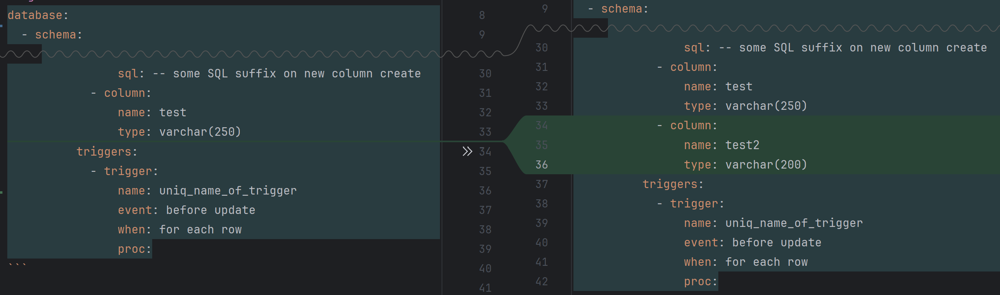

## Declarative schema in a YAML file format

The schema provided there: [schema](src/schema.yaml). The yaml-validator is use to check the schema validity.

Key features: 

> [!TIP]
> - Track schema changes in a single file with github history
> - Aggregate changes from multiple commiters and tolerate to execution order
> - The app will append DB structure with generated SQL safely,  and will not perform destructive SQL 


### Its source: one database vendor's schema written as another's

**Conversion, in short** (owner, 2026-11-19): a schema is converted on apply, for its target
only - a PostgreSQL dump applied to PostgreSQL is applied as it is, nothing mapped. A schema
written by hand, with no `source`, is PostgreSQL's. Custom SQL is ignored on a mapping to
another vendor.

At the top level, beside `database:`, `source: <vendor>.<version>` says where a schema was taken from
(`postgres.16`, `mysql.8.0`, `sqlite`): the vendor's own version, a major or more parts. sge's
snapshot writes it, and a schema without it is PostgreSQL's. Applied to another vendor's database,
the schema goes through a mapping first (`schema_guard_tokio::mapping`, the files in
[src/mappings](src/mappings)): one file a pair of vendors, its `default` rules for every version,
and version cases before them - of each side's cases, the newest one at or below its version, so a
newer server takes what an older one takes, by backward compatibility. Each type and default is matched and written as the target's, kept or
refused; each feature (an index method, a partition, triggers, grants, an owner) kept, dropped or
refused. What no rule maps is refused, every refusal listed at once, before any statement runs.
A literal default goes through the rules too and stays as written when none names it: a boolean's
`0` and `1` of MySQL and SQLite become PostgreSQL's `false` and `true`.

Built in, each way between the three: `postgres-mysql`, `postgres-sqlite`, `sqlite-postgres`,
`sqlite-mysql`, `mysql-postgres`, `mysql-sqlite`.

**Custom SQL is ignored on a cross-vendor apply:** the `sql` of a table, a column, an index or a
foreign key, and a table's `constraint`, are one vendor's own and are left out, each one said. A
column's `sql` of keywords every vendor reads alike is converted to the schema's own fields
instead: `UNIQUE` to its index's `unique: true` (named `<table>_<column>_key` when it has none),
`NOT NULL` and `NULL` to `nullable`, `PRIMARY KEY` to `primaryKey`.

### Track schema changes



### Most often case during development: add column

SQL:
```sql
create table test (
    column defenition,
    new_column int -- adding this
)
```

but this wont work, if you already have a table. So

```sql
alter table test add column IF NOT EXISTS new_column int;
```
but this wont work if you do not have a table.


### Support plain SQL as inserts into a column creation statement

```yaml
          columns:
            - column:
                name: id
                type: serial
                sql: -- some SQL suffix on new column create
```

Also work for many other places like table, constraint and triggers

> [!NOTE]
> Changing this SQL wont update a DB schema
 

